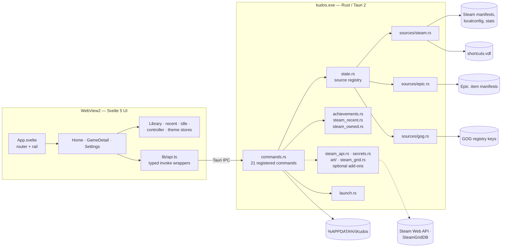

# Kudos — Architecture

Kudos is a Windows desktop launcher that reads the games already installed through **Steam, Epic
Games and GOG** and presents them in one controller-first library. This document describes the
shipped architecture and clearly labels the optional, key-gated add-ons.

- **Runtime:** Tauri 2 (Rust) + the system **WebView2** runtime.
- **UI:** Svelte 5 + TypeScript + Vite, compiled to static files.
- **Target:** Windows 10/11 x64. There is no macOS or Linux build.
- **No account, no telemetry, no background updater.**

---

## 1. Design constraints

These constraints explain most of the code structure:

1. **Local files are the source of truth.** The library is built from Steam manifests, Epic
   manifests and GOG registry entries. Listing a library must work with the network disconnected.
2. **One wire shape.** Every store is normalised into the same `Game` struct before it reaches the
   frontend. Pages never branch on “which store scanner produced this row”.
3. **A broken store must not break the app.** A source that fails is logged and skipped; a missing
   store client is an empty section, not an error dialog.
4. **No polling.** The app does not watch the filesystem or poll Steam. Scans are cached by file
   metadata and refresh on an explicit user action or restart.
5. **Small shell, fixed floor.** The Rust executable stays small. WebView2 sets the memory floor;
   the app avoids large JS libraries, unbounded image caches and per-frame work.
6. **Destructive writes are narrow and reversible.** The only store file Kudos writes is Steam's
   `shortcuts.vdf`, behind a running-Steam check, a backup and a round-trip validation.

---

## 2. Process and layer map

Kudos has two processes at runtime:

- `kudos.exe` — the Rust host. It owns window creation, command handlers, store scanners, local
  persistence and process launches.
- WebView2 subprocesses — the Edge runtime that renders the Svelte bundle. They are part of the
  Windows WebView2 installation, not bundled with Kudos.

The frontend cannot read the filesystem or start a process directly. Every privileged operation
goes through a Tauri command in `src-tauri/src/commands.rs`. The typed wrappers in `src/lib/api.ts`
are the only place the UI is allowed to call `invoke`.



The optional add-ons (`steam_api.rs`, `secrets.rs`, `art/`, `steam_grid.rs`) are registered as
commands in this build but stay opt-in: they require a user-supplied key and are never called while
listing the library. See §10.

---

## 3. Repository map

| Path | Responsibility |
| --- | --- |
| `src/App.svelte` | App shell, left rail, page switching, global keyboard handling, brand mark. |
| `src/pages/Home.svelte` | Hero banner, filters, media rows, launch/install overlay, idle arming. |
| `src/pages/GameDetail.svelte` | Cover/hero, facts, Play/Install, Add to Steam, achievements, favorite/hide. |
| `src/pages/Settings.svelte` | Steam status and library card, controller, idle, personalization, hidden games, About. |
| `src/lib/api.ts` | Typed wrappers around the Tauri commands. The only IPC entry point. |
| `src/lib/library.svelte.ts` | Loads installed games, merges the owned Steam catalog, joins playtime, sort/hidden prefs. |
| `src/lib/steam.ts` | Merge rules for installed + owned entries, playtime map and labels. |
| `src/lib/router.svelte.ts` | Tiny in-memory router: `home`, `game`, `settings`. |
| `src/lib/controller.svelte.ts`, `gamepad.ts` | Gamepad detection, layout classification, polling and navigation. |
| `src/lib/idle.svelte.ts` | Idle preferences, activity detection, timer and ambient state. |
| `src/lib/art.ts` | Local/CDN cover resolution, Steam hero candidates, gradient placeholders. |
| `src/lib/components/` | Hero, media rows, tiles, boot splash, brand mark, overlays, settings cards, artwork picker, glyphs, toasts. |
| `src-tauri/src/lib.rs` | Tauri builder and the **only** command registration list. |
| `src-tauri/src/commands.rs` | Command surface and the launch/install/Add-to-Steam flows. |
| `src-tauri/src/state.rs` | `AppState`: the ordered registry of `LibrarySource` implementations. |
| `src-tauri/src/models.rs` | Wire contracts: `Game`, `Platform`, `SteamStatus`, `AchievementSummary`. |
| `src-tauri/src/sources/mod.rs` | `LibrarySource` trait. |
| `src-tauri/src/sources/steam.rs` | Steam discovery, VDF parsing, cover paths, Add-to-Steam binary writer. |
| `src-tauri/src/sources/epic.rs` | Epic `.item` parsing, filtering, launch fallback. |
| `src-tauri/src/sources/gog.rs` | GOG registry scanning and direct executable launch. |
| `src-tauri/src/achievements.rs` | Local Steam achievement summary from binary stats files. |
| `src-tauri/src/steam_recent.rs` | Steam `LastPlayed` + Kudos launch journal, merged. |
| `src-tauri/src/steam_owned.rs` | Local owned catalog, playtime, name cache, opt-in metadata sync. |
| `src-tauri/src/steam_api.rs` | Optional Steam Web API complete-owned-library client, six-hour cache, DPAPI key adapter. |
| `src-tauri/src/secrets.rs` | DPAPI-encrypted provider-key vault (`steam`, `steamgriddb`). |
| `src-tauri/src/art/` | SteamGridDB search, HTTPS image validation, artwork cache. |
| `src-tauri/src/steam_grid.rs` | Write cached grid/hero/logo/icon art into Steam's `config/grid`. |
| `src-tauri/src/error.rs` | `SourceError` / `SourceResult`, user-readable messages. |
| `src-tauri/src/launch.rs` | Spawn an executable or hand a URI to the Windows shell. |
| `src-tauri/tests/` | Fixtures and the real-machine registry integration test. |

The frontend has no UI framework beyond Svelte and no animation library. The Rust side has no HTTP
crate; every outbound request uses WinHTTP directly.

---

## 4. Data model

`src-tauri/src/models.rs` and `src/lib/types.ts` are a pair. Change both in the same commit.

### `Game`

```text
id              "steam:730" | "epic:Fortnite" | "gog:1207658924"
platform        "steam" | "epic" | "gog"
title           display name
exePath?        absolute executable path when the store exposes one
launchCommand   URI or executable used by the source
isInstalled     false for owned-but-not-installed Steam entries
coverImage?     https URL or absolute local file path
sizeBytes?      installed size when known
```

The `id` is the stable key across commands, recent history, favorites, playtime and hidden-game
preferences. A source must never change the id format for an existing game.

### Supporting shapes

| Shape | Fields | Producer |
| --- | --- | --- |
| `SteamStatus` | `installed`, `running`, `steamPath?` | `get_steam_status` |
| `AchievementSummary` | `supported`, `unlocked`, `total`, `reason?` | `get_achievements` |
| `SteamPlaytime` | `appId`, `minutes`, `twoWeeksMinutes`, `lastPlayed?` | `get_steam_playtime` |
| `SteamSyncStatus` | `cached`, `appCount`, `fetchedAt?`, `ownedAppCount` | sync status commands |
| `RecentGame` | `id`, `lastPlayedUnix`, `source` (`steam` or `kudos`) | `get_recent_games` |

`AchievementSummary` is intentionally non-failing: unsupported platforms and unreadable local data
return `supported: false` instead of rejecting the command.

---

## 5. Source registry

`AppState` owns exactly one instance of each source, in display order:

```text
SteamSource -> EpicSource -> GogSource
```

Each source implements the same trait:

```rust
pub trait LibrarySource: Send + Sync {
    fn platform(&self) -> Platform;
    fn installed(&self) -> SourceResult<Vec<Game>>;
    fn launch(&self, game: &Game) -> SourceResult<()>;
}
```

`AppState::all_games()` calls every source, logs a failed source and continues, then sorts by title
and removes duplicate ids. `find_game()` re-scans to resolve one id; there is no persistent index.
Each source is cheap to construct and holds its own cache behind a `Mutex`.

### 5.1 Steam

- Finds the Steam root from `HKCU\Software\Valve\Steam\SteamPath`, then HKLM views, then the two
  default install folders as a last resort.
- Parses `steamapps/libraryfolders.vdf` in both modern (`"0" { "path" ... }`) and legacy
  (`"1" "D:\\Library"`) layouts.
- Reads every `steamapps/appmanifest_*.acf`; `StateFlags & 4` decides `isInstalled`.
- Skips app id `0` and Steamworks Common Redistributables (`228980`); de-duplicates the same app id
  found in two libraries.
- Prefers a local `appcache/librarycache` cover, then the CDN `library_600x900.jpg`.
- Caches the root, library list and each manifest by `(mtime, size)`; unchanged files are not
  reparsed.
- Launches through `steam://rungameid/<appid>`, so Steam Cloud, overlay and playtime continue to
  work.

The module also contains a complete binary-VDF reader/writer for `shortcuts.vdf`. It preserves
unknown fields, generates a deterministic shortcut app id, updates an existing shortcut instead of
duplicating it, and refuses to write while `steam.exe` is running.

### 5.2 Epic Games

- Reads installed-app `*.item` JSON manifests from
  `%PROGRAMDATA%\Epic\EpicGamesLauncher\Data\Manifests` (overridable with
  `KUDOS_EPIC_MANIFEST_DIR` for fixture tests).
- Skips incomplete installs, DLC, plugins, engine assets, manifests without a launch target and
  installs whose folder no longer exists.
- Keeps the newest build when several manifests describe the same app.
- Caches by a signature of the manifest directory (path, size, mtime).
- Launches through `com.epicgames.launcher://apps/<AppName>?action=launch&silent=true` when the
  launcher is present, with a direct executable fallback.

Epic cover art is intentionally absent: the manifest has no stable cover URL, so the UI draws the
platform-tinted gradient placeholder.

### 5.3 GOG

- Scans three registry roots, in priority order:
  `HKLM\SOFTWARE\WOW6432Node\GOG.com\Games`, `HKLM\SOFTWARE\GOG.com\Games` and
  `HKCU\Software\GOG.com\Games`.
- Reads `gameId`/`productId`, title, install path, executable, working directory, launch arguments
  and size.
- Hides stale entries whose install folder is gone.
- Caches a successful scan for five seconds; registry reads are cheap, and the short TTL avoids
  duplicate scans when `list_games` and `launch_game` are called back to back.
- Launches the executable directly with the recorded arguments and working directory, so GOG
  Galaxy is not required.
- Uses a local `GOG.ico` when present; otherwise the UI draws the gradient placeholder.

Epic and GOG are covered by unit tests and fixtures, but neither client is installed on the
development machine. See [Troubleshooting](TROUBLESHOOTING.md#epic-or-gog-not-detected).

---

## 6. Command surface

`src-tauri/src/lib.rs` registers exactly these 21 commands. Adding a command there makes it callable
from the WebView; adding a module alone does not.

| Command | Kind | Network | Purpose |
| --- | --- | --- | --- |
| `list_games` | sync | no | Every game from every source, merged and title-sorted. Grants local cover files to the asset protocol. |
| `launch_game` | sync | no | Launch an installed game, or open `steam://install/<appid>` for an owned-only Steam entry. |
| `add_to_steam` | sync | no | Write a non-Steam shortcut into the active Steam profile. |
| `get_steam_status` | sync | no | Registry-based Steam installed/running/path status. |
| `get_recent_games` | sync | no | Steam `LastPlayed` merged with Kudos' launch journal. |
| `get_achievements` | sync | no | Local Steam achievement count for one `steam:<appid>`. |
| `get_steam_owned_games` | sync | no | Owned-but-not-installed Steam apps from `localconfig.vdf`. |
| `get_steam_playtime` | sync | no | Per-app playtime and last-played timestamps. |
| `get_steam_sync_status` | sync | no | Name-cache status for the Settings card. |
| `sync_steam_metadata` | async | **yes** | Download Steam's public app list once, filter it to known ids and replace the name cache. |
| `get_secret_status` | sync | no | Whether a DPAPI provider key exists; never returns key material. |
| `set_secret` | sync | no | Validate and store a provider key in the DPAPI vault. |
| `clear_secret` | sync | no | Delete a provider key from the vault. |
| `search_art` | sync | **yes** | Query SteamGridDB for grid/hero/logo/icon candidates for one game. |
| `apply_art` | sync | **yes** | Download one validated image into the art cache and, when a shortcut exists, write it into Steam's grid folder. |
| `get_art_status` | sync | no | Cached artwork and its source for one game. |
| `get_steam_api_status` | sync | no | Whether a Steam Web API key exists, cache age and owned count. |
| `set_steam_api_key` | sync | **yes** | Validate and save a Steam Web API key, then attempt one owned-games sync. |
| `clear_steam_api_key` | sync | no | Delete the saved Steam Web API key. |
| `sync_steam_owned` | sync | **yes** | Refresh the complete owned-games cache from Steam. |
| `get_steam_owned_api_games` | sync | no | Return cached API-owned games, already shaped as `Game`. |

The core library makes only one application-level network request: `sync_steam_metadata`, after an
explicit user action. It runs on a blocking worker so a slow response cannot freeze the WebView. The
optional add-ons add user-triggered requests: `search_art` and `apply_art` talk to SteamGridDB;
`set_steam_api_key` and `sync_steam_owned` talk to Steam's Web API. None of them runs during startup
or while merely listing the library. Cover images and Steam hero art are loaded by the WebView from
Steam's CDN; that is browser image loading, not an API client in Kudos.

---

## 7. Data flows

### 7.1 Startup and library load

1. `App.svelte` mounts, plays the brand boot splash (skippable, reduced-motion aware), applies the
   saved accent/background/density, starts controller detection and restores the optional startup
   page and borderless-fullscreen preference.
2. `Home.svelte` calls `loadLibrary()`.
3. `list_games` runs `AppState::all_games()`, which scans Steam, Epic and GOG. Before returning,
   every local cover path that exists is granted to Tauri's asset protocol one file at a time.
4. The installed library is rendered immediately. `hydrateSteam()` then calls
   `get_steam_owned_games`, `get_steam_playtime`, `get_steam_sync_status` and
   `get_steam_owned_api_games` in parallel.
5. The frontend merges installed, API-owned and local-catalog-owned entries by id (installed wins,
   API is the superset), joins playtime by id and rebuilds the rows. If an additive command is
   missing or the API cache is absent, the installed-only library stays usable.

The static asset-protocol scope is intentionally narrow; runtime grants cover unusual Steam library
locations without opening the whole filesystem.

### 7.2 Launch

```text
Home / GameDetail
  -> launchGame(id)
  -> commands::launch_game
     -> find installed game in the source registry
        -> source.launch(game)
           -> Steam: steam://rungameid/<appid>
           -> Epic:  launcher URI, then direct exe fallback
           -> GOG:   direct exe + working dir + launch args
     -> if not installed: steam_owned::install_command(id)
        -> steam://install/<appid>
     -> on a successful installed launch: record_launch(id)
```

`launch::open` spawns an existing file directly; anything else is handed to `cmd /C start`, which
lets Windows resolve store protocols. The launch journal write is best-effort and never changes the
launch result. Installing an owned game is not recorded as a play.

### 7.3 Add to Steam

```text
GameDetail (non-Steam game)
  -> addToSteam(id)
  -> commands::add_to_steam
     -> reject Steam games
     -> detect Steam root and confirm steam.exe is not running
     -> resolve a real local executable
     -> find the active userdata profile
     -> read shortcuts.vdf
     -> parse binary VDF into an ordered tree
     -> insert or update the shortcut
     -> serialise, parse the result again to validate it
     -> write shortcuts.vdf.kudos-backup
     -> temp file + rename over shortcuts.vdf
```

The writer never replaces a file it cannot parse. Unknown fields and existing shortcuts survive the
round trip. Re-adding the same title/executable updates the existing entry instead of creating a
duplicate. Steam must be fully closed because it rewrites the file from memory on exit.

### 7.4 Opt-in Steam metadata sync

```text
Settings -> Sync now
  -> syncSteamMetadata()
  -> commands::sync_steam_metadata
     -> known app ids from the local Steam catalog
     -> spawn_blocking
        -> WinHTTP GET Steam's public app list
        -> fall back to Steam's keyless store batch endpoint if needed
        -> filter to known ids
        -> atomic replace of %APPDATA%\Kudos\steam-apps.json
     -> SteamSyncStatus
  -> loadLibrary(true) to refresh names
```

The cache is small, filtered to ids Kudos can display, and replaced with a temp file + rename. A
failed sync leaves the previous cache untouched and returns a readable error string. This is the
only network call made by the core library, and it is never made at startup.

### 7.5 Achievements

`get_achievements` resolves the active Steam profile, reads
`appcache/stats/UserGameStats_<account>_<appid>.bin` and
`appcache/stats/UserGameStatsSchema_<appid>.bin`, parses both binary VDF trees and counts unlocked
bits. Results are cached by `(Steam root, account, appid)` plus both files' `(mtime, length)`.
Missing, locked or unexpected files return `supported: false` with a short reason. There is no
network request and no Steam Web API key.

### 7.6 Recently played and playtime

`get_recent_games` merges Steam's per-account `LastPlayed` values with
`%APPDATA%\Kudos\recent.json` (Kudos' own launch journal), filters to ids that still exist in the
current library and returns the newest first. `get_steam_playtime` reads the same
`localconfig.vdf`, cached by file metadata, and returns minutes, last-two-weeks minutes and the
last-played timestamp. The frontend keeps a small localStorage mirror so a launch updates the row
before the next backend round trip.

### 7.7 Idle mode

`Home.svelte` arms the idle watcher only while the Home page is mounted. Pointer, keyboard, wheel and
touch activity update a timestamp; the timer is rescheduled at most twice per second. Gamepads are
polled at 2 Hz, not per frame. The timer pauses while the window is hidden or unfocused, and the
ambient screen refuses to open when there is nothing to show. Any real input exits after a short
grace period. This is an ambient display, not a screensaver: it does not blank the display or stop
the GPU.

### 7.8 Controller and glyphs

`controller.svelte.ts` classifies the Gamepad API's `id` string once per connect event into Xbox,
PlayStation, Nintendo or generic. A user override in `kudos.padLayout` wins over auto-detection, and
`keyboard` forces keycaps even with a pad connected. `gamepad.ts` owns the polling loop and repeat
handling; glyph components only render the effective layout.

### 7.9 Optional complete Steam library

```text
Settings -> Complete Steam library -> Save / Test
  -> set_steam_api_key / sync_steam_owned
     -> validate the 32-hex key shape
     -> DPAPI-store it under provider "steam"
     -> WinHTTP GET api.steampowered.com/IPlayerService/GetOwnedGames/v1/
     -> filter non-games, map app ids to "steam:<appid>"
     -> atomic replace of %APPDATA%\Kudos\steam-owned-api.json
  -> get_steam_owned_api_games (cache only, no network)
  -> hydrateSteam() merges installed + API + localconfig entries
```

The cache is valid for six hours. Opening the Settings card with a saved key and a stale cache
triggers one silent refresh 1.5 seconds after the card is interactive; app startup itself never calls
Steam. `Save` and `Test` are explicit. A private profile returns Steam's empty response and an
actionable message; the previous cache is kept on failure. Installed copies always win over API
copies for the same app id.

### 7.10 Optional SteamGridDB artwork

```text
Settings -> Artwork / GameDetail -> Change artwork
  -> search_art(game_id, kind)
     -> read the DPAPI "steamgriddb" key
     -> WinHTTP GET SteamGridDB search API
  -> apply_art(game_id, url, kind)
     -> HTTPS-only, host pinned to steamgriddb.com and subdomains
     -> 8 MB cap, image content-type + magic-byte check
     -> write %APPDATA%\Kudos\art\<game>-<kind>.<ext>
     -> if a non-Steam shortcut exists, write the matching file into Steam's config/grid
     -> return wroteToSteam + steamError
```

Artwork is an override, never a replacement for the built-in cover chain. A missing key, a missing
non-Steam shortcut, Steam running or a download failure leaves the existing art and library intact.
The Settings **Artwork** card and the detail-page **Change artwork** picker are the UI surface; both
are mounted in this snapshot. The backend commands remain registered independently.

---

## 8. Frontend state and persistence

Svelte 5 runes (`$state`, `$derived`) hold the library, playtime, sync status, recent entries,
favorites, idle state, controller state and toasts. There is no global state library.

| Store | Storage | Scope |
| --- | --- | --- |
| Library + sort + hidden ids | `kudos.sort`, `kudos.hiddenGames` | localStorage |
| Filter | `kudos.libraryFilter` | localStorage |
| Favorites | `kudos.favorites` | localStorage |
| Recent mirror | `kudos.recentLaunches` | localStorage |
| Idle settings | `kudos.idle` | localStorage |
| Controller override | `kudos.padLayout` | localStorage |
| Accent / background / density | `kudos.accent`, `kudos.background`, `kudos.density` | localStorage |
| Crossfade / startup page / fullscreen | `kudos.crossfade`, `kudos.startupPage`, `kudos.fullscreen` | localStorage |
| Launch journal | `%APPDATA%\Kudos\recent.json` | per Windows user |
| Steam name cache | `%APPDATA%\Kudos\steam-apps.json` | per Windows user |
| Complete Steam library cache | `%APPDATA%\Kudos\steam-owned-api.json` | per Windows user |
| Artwork cache | `%APPDATA%\Kudos\art\` | per Windows user |
| DPAPI provider keys | `%APPDATA%\Kudos\secrets.bin` | per Windows user |

All localStorage access is wrapped in `try/catch`: a locked-down or full profile degrades to
defaults instead of breaking the UI.

---

## 9. Security, privacy and performance

### Security boundaries

- **CSP** (`tauri.conf.json`): scripts only from the app itself; images from the app, Tauri's asset
  protocol, HTTPS, `data:` and `blob:`; connections only to the app and Tauri IPC.
- **Asset protocol:** enabled, with a static scope for the default Steam library caches. Other
  local covers are granted file-by-file at runtime by `list_games`.
- **No shell plugin.** The frontend cannot ask Rust to run an arbitrary command. `launch_game`
  only resolves an id that exists in a source, and each source validates the platform before
  launching.
- **Add to Steam** only accepts non-Steam games with a real local executable, refuses to run while
  Steam is running, backs up the original file and validates its own output before replacing it.
- **Secrets:** the optional Steam Web API and SteamGridDB keys live in a DPAPI-encrypted vault at
  `%APPDATA%\Kudos\secrets.bin`, never in localStorage, config files or logs. Commands return only
  `hasKey`, a masked hint and status metadata; the key itself never crosses IPC.

### Privacy

Kudos has no account, analytics, crash reporting or telemetry. Library scanning is local. The core
library makes one outbound application request, the user-triggered Steam metadata sync. Optional
add-ons add user-triggered requests: Steam's Web API only after a key is saved, and SteamGridDB only
when artwork is searched or applied. A saved Steam key also refreshes a stale cache once, 1.5 seconds
after the Settings card is opened. Cover art may be loaded from Steam's CDN by the WebView; local
covers are preferred and work offline.

### Performance evidence

Measured on the release build at the Session H/I baseline:

| Metric | Value |
| --- | --- |
| Native `kudos.exe` private memory, idle | ~6.3 MB |
| WebView2 private memory, empty shell | ~175 MB |
| WebView2 private memory with three local covers decoded | ~244 MB |
| Frontend JS | ~178.5 KB uncompressed / ~58.2 KB gzip |
| Frontend CSS | ~67.6 KB uncompressed / ~12.35 KB gzip |
| NSIS installer | ~1.43 MiB |

The WebView2 number is the Edge runtime and GPU floor, not Rust growth. The budget rule is that
Kudos' own code must not grow it meaningfully: no polling, no large JS dependencies, no unbounded
image cache. Animations use `transform` and `opacity`; `prefers-reduced-motion` removes the
non-essential ones.

---

## 10. Optional add-ons

These modules are compiled and registered in this build. They stay opt-in: no key is required for the
core app, and no request is made without a user action (or the one stale-cache refresh described
above).

| Module | What it contains | UI status in this snapshot |
| --- | --- | --- |
| `src-tauri/src/steam_api.rs` | Steam Web API `GetOwnedGames` client, six-hour cache, privacy/rate-limit messages, DPAPI-backed key. | `SteamKeyCard` is mounted in Settings as **Complete Steam library**; API-owned games merge into the library. |
| `src-tauri/src/secrets.rs` | Windows DPAPI vault for provider keys (`steam`, `steamgriddb`), atomic writes, masked status. | Used by the Steam key card and the artwork backend. |
| `src-tauri/src/art/` + `steam_grid.rs` | SteamGridDB search/download and writing grid/hero/logo/icon files into Steam's `config/grid`. | `ArtworkCard` is mounted in Settings as **Artwork**; non-Steam detail pages mount `ArtPicker` behind **Change artwork**. |
| `src/lib/components/SteamKeyCard.svelte`, `src/lib/steamKey.ts` | Settings UI and typed wrappers for the optional complete library. | Mounted and wired into `hydrateSteam()`. |

The artwork path needs a real-key validation pass and coverage of missing-shortcut, offline and
rate-limit failures before it can be called complete. The Steam key path has a Settings card and
library merge; a real key has not been exercised in this session. Keep both labelled as optional in
user-facing copy, and never imply that a key is required.

---

## 11. Testing and validation

| Gate | What it proves |
| --- | --- |
| `npm run check` | Svelte + TypeScript: 0 errors, 0 warnings at the Session I baseline. |
| `npm run rust:test` | Unit tests for VDF/binary-VDF parsing, source filters, merge rules and caching; registry integration test on the real machine; fixture tests for Epic/GOG. |
| `npm run build` | Production frontend bundle and budget check. |
| `npm run tauri build` | Release `kudos.exe` and the NSIS installer. |
| Visual smoke | 1600×1000 screenshots of home, detail, settings, search, idle and onboarding, with console-error checks. Optional add-on cards and the detail artwork picker are included. |

The known validation gaps are honest and tracked:

- Epic and GOG are **fixture-only** on the development machine; neither client is installed.
- A live Add-to-Steam write has not been completed end-to-end because Steam was running during the
  final pass. The refusal path and the file writer are tested with fixtures.
- No physical controller was available for the final visual pass; the glyph system was exercised
  with keyboard and mock pad layouts.

---

## 12. Extension points

### Adding a store

1. Implement `LibrarySource` in `src-tauri/src/sources/<store>.rs`.
2. Return `Ok(Vec::new())` when the client is absent, and `Err(SourceError::...)` only when the
   client exists but cannot be read.
3. Register the source once in `AppState::new()`.
4. Add a `Platform` variant and update `src/lib/types.ts` plus `PLATFORM_LABEL`.
5. Add fixtures and a test for the parser; never put store-specific branching in `Home.svelte`.

### Adding a command

1. Add the handler to `commands.rs` and register it in `lib.rs`.
2. Add a typed wrapper in `src/lib/api.ts`; do not call `invoke` from a component.
3. Treat a missing command as “feature unavailable” on the frontend if the command is additive.
4. Update the contract table in `TARGET.md` and this document.

### Adding artwork

The default path is local cover → Steam CDN → gradient placeholder. The optional SteamGridDB module
is an override: search, download to a cache, then write into Steam's grid folder only when the
non-Steam shortcut already exists. It must never write orphan files or replace user art without an
explicit choice.

---

## 13. Known architectural limitations

- Steam listing is manifest-based: a never-installed title has no local `appmanifest_*.acf`.
- The local Steam catalog can miss never-installed titles; the optional Web API key fills them in.
- GOG listing is registry-based: library-only GOG games do not appear.
- Epic cover art is absent by design; the manifest has no stable cover URL.
- Local cover scope is narrow; unusual Steam layouts may fall back to the CDN or the gradient.
- Optional SteamGridDB art needs a key and a non-Steam shortcut before it can update Steam's grid.
- There is no filesystem watcher. New installs require a rescan or restart.
- The installer is unsigned; SmartScreen may warn on first run.
- The WebView2 memory floor makes a sub-100 MB total impossible without replacing the runtime.

For user-facing symptoms and fixes, see [Troubleshooting](TROUBLESHOOTING.md). For the feature
status split, see [Roadmap](ROADMAP.md).
