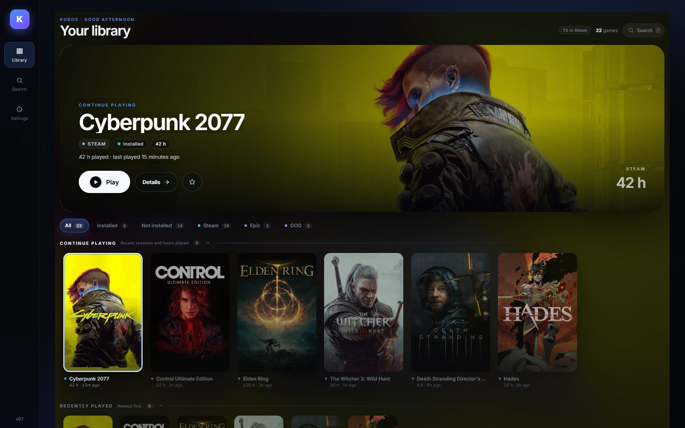
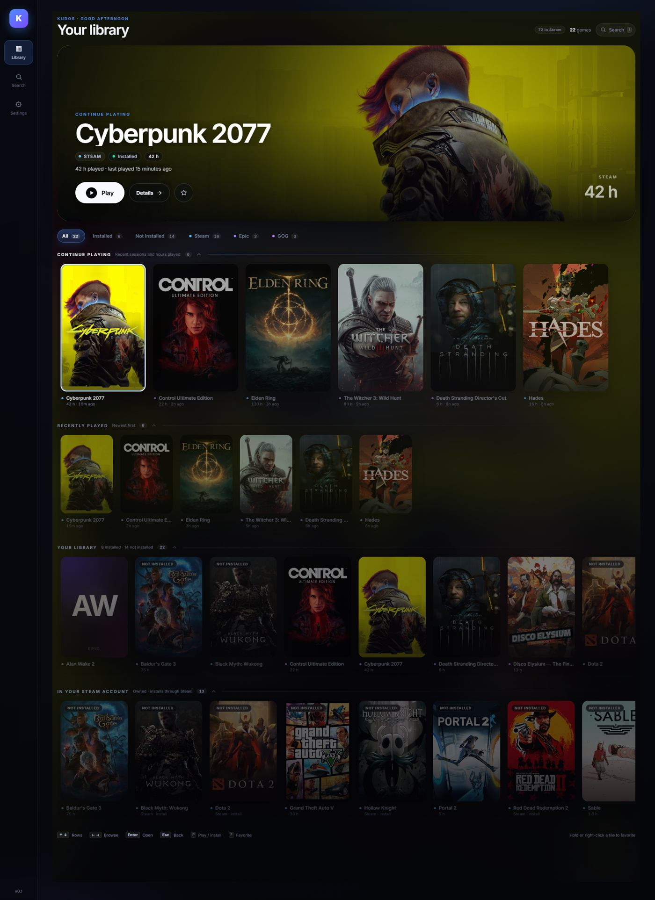
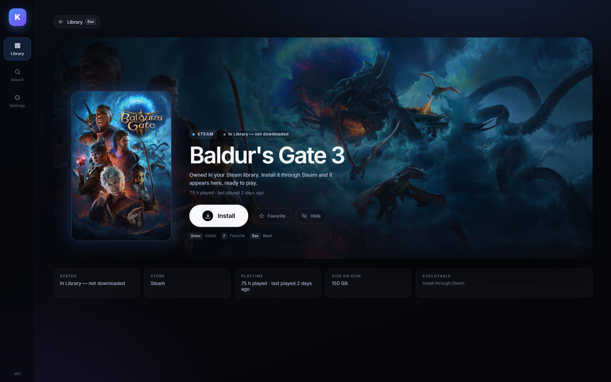
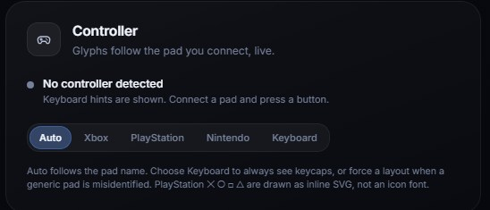
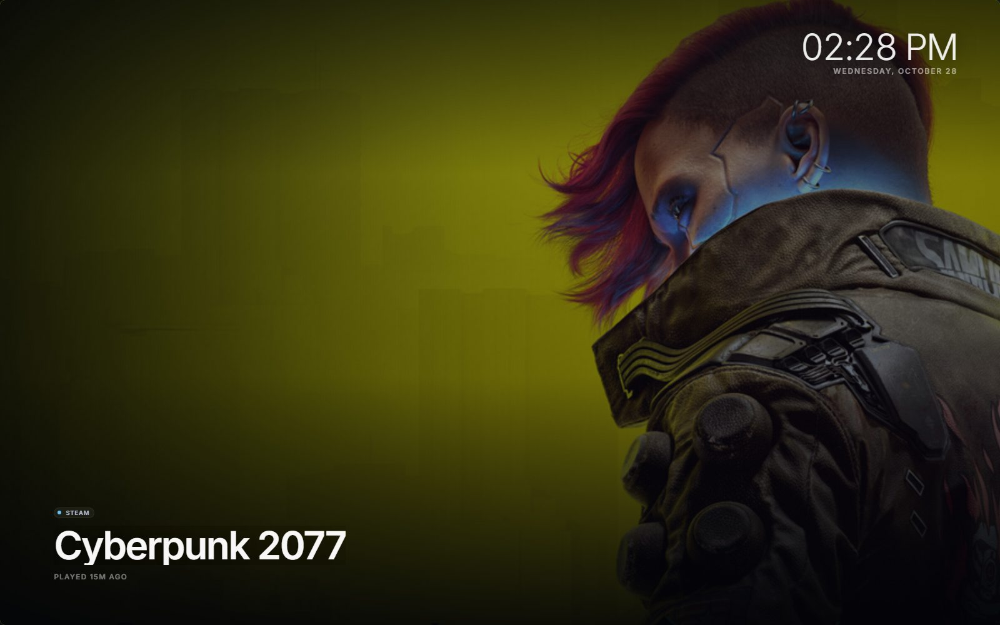
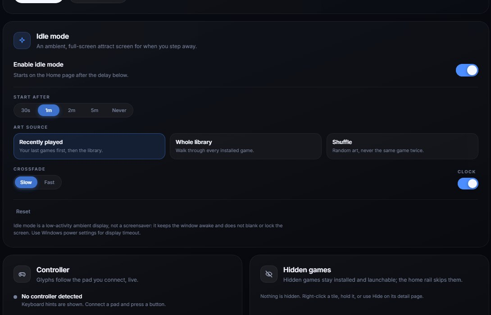
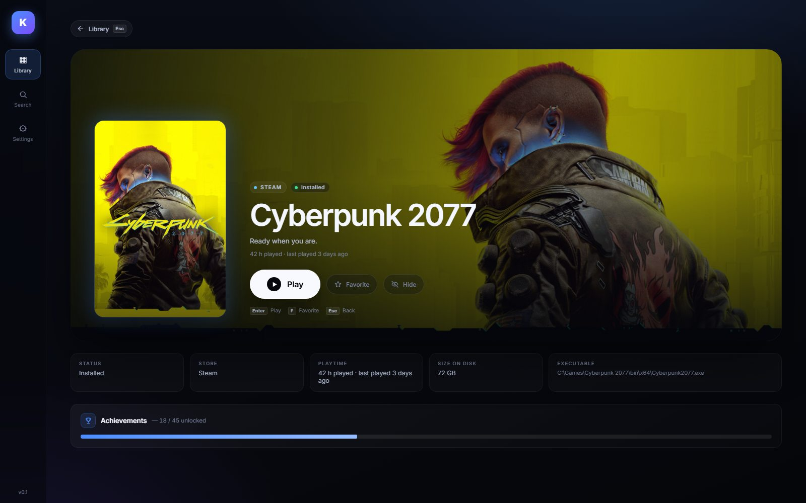
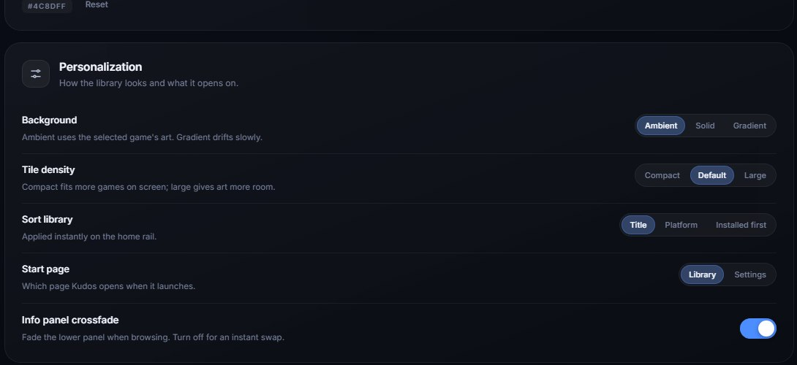
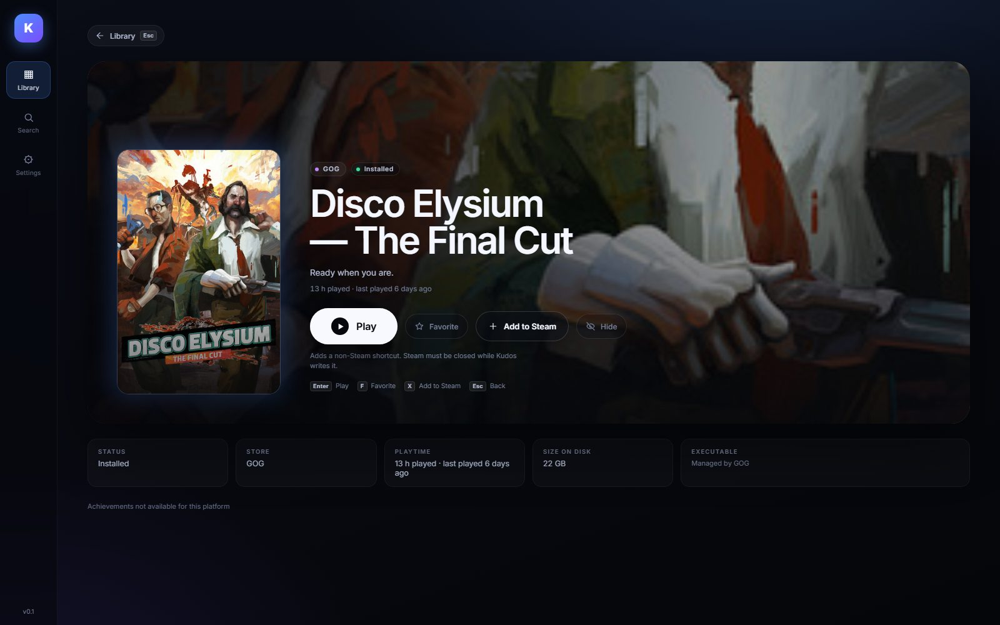

# Kudos — User Guide

Kudos is a lightweight, controller-first Windows launcher for the games you already own on
**Steam, Epic and GOG**. It puts them in one PS5-style library, with one Play button, and launches
each game through its real store client so cloud saves, overlays and playtime keep working.

Kudos is a desktop app for **Windows 10/11 (x64)**. It does not need an account, does not show ads,
and does not send telemetry.

> **New here?** Install Kudos from the
> [latest release](https://github.com/Rohit4738/Kudos8/releases/latest), open it, and wait for the
> first scan. If the library is empty, see [Troubleshooting](TROUBLESHOOTING.md#no-games-found).

---

## 1. First launch

When Kudos opens for the first time it plays a short brand boot animation (logo, accent bloom and
wordmark), then scans the store clients installed on this PC. The animation is about 1.1 seconds
long, any input skips it, and reduced-motion mode uses a plain 200 ms fade. The scan reads local files
only; nothing is uploaded. If no games are found, Home shows a first-run panel with **Sync Steam
library** and **Scan this PC** instead of an empty grid.

The first screen has four parts:

- **The hero banner** at the top. It shows the game you are focused on, its store, whether it is
  installed, and its playtime. **Play** starts it; **Details** opens the full page.
- **Filter chips** under the hero: **All**, **Installed**, **Not installed**, **Steam**, **Epic**
  and **GOG**. All six stay visible; a store with no games shows `0` and a friendly empty state. The
  number on each chip is a live count.
- **Media rows** below the filters: **Favorites**, **Continue playing**, **Recently played**,
  **Your library**, and **In your Steam account**.
- **The left rail** for **Library**, **Search** and **Settings**.

The header also shows how many games are in the current library and how many Steam apps Kudos knows
about. On a machine with three installed Steam games and a larger owned catalog, those two numbers
can be very different — the second one includes games you own but have not installed.

> **First scan is local and quick.** Kudos reads Steam manifests, Epic manifests and GOG registry
> entries. It does not wait for the network. If a store client is missing, that store simply has no
> games; you do not get an error dialog.

---

## 2. The library rows

Rows are ordered by usefulness, not alphabetically:

| Row | What it contains |
| --- | --- |
| **Favorites** | Games you pinned. Appears only when you have favorites. |
| **Continue playing** | Installed games from your recent sessions (up to eight). If there is no history, installed games with recorded playtime, most-played first. |
| **Recently played** | Steam's last-played timestamps merged with Kudos' own launch history. |
| **Your library** | Everything currently known, installed and owned-not-installed. |
| **In your Steam account** | The owned-but-not-installed subset from Steam's local account data. |

Rows are **independently focusable**. Use **Up/Down** to change rows and **Left/Right** to move
between tiles. **Enter** opens the focused game, **Esc** goes back. On a controller, use the d-pad or
left stick and the face buttons; **L1/R1** cycle the filter chips, **Start** opens the left rail, and
pressing **Left** on the first tile of a row opens it too. In **Settings** and on a game's detail page,
the d-pad/stick walks the visible controls and scrolls the page. The footer shows the exact glyphs for
the pad Kudos detected.

### Search

Press **`/`** or **Ctrl+K** to open search. Type part of a title; the list
narrows as you type. **Up/Down** selects, **Enter** opens the detail page, **Esc** closes the
overlay. Search is local and works without a network connection.

### Favorites

Press **F** on a focused tile, hold a tile, right-click it, or use the star button on the detail
page. Favorites are stored on this PC and appear in the **Favorites** row at the top of the library.
Remove one from **Settings → Favorites**, or clear them all there.

### Filters

Choose **Installed** to see only games whose files are present, or **Not installed** to see the
owned catalog. All six chips stay visible; a store with no games shows `0` and a short empty-state
message. Your last filter is remembered.

---

## 3. Playing a game

1. Focus a tile and press **Enter**, or open **Details** and choose **Play**.
2. Kudos hands the launch to the real client:
   - **Steam** games open with `steam://rungameid/<appid>`, so Steam Cloud, the overlay and playtime
     continue to work.
   - **Epic** games open through the Epic Games Launcher when it is installed, with a direct
     executable fallback.
   - **GOG** games start the installed executable with the working directory and launch arguments
     GOG recorded.
3. A short "Launching" overlay appears while Windows hands over to the game. If the launch fails,
   Kudos shows the error instead of silently doing nothing.

Kudos records successful launches in its own recent list. It does **not** record an install as a
play.

---

## 4. Installing an owned game that is not installed

Steam's local account data can list games you own but have not downloaded. They appear with a
**Not installed** badge and a muted cover.

1. Open the game's **Details** page.
2. Choose **Install**. Kudos opens Steam's install dialog with `steam://install/<appid>`.
3. Approve the install in Steam and wait for it to finish.
4. Return to Kudos and choose **Rescan this PC** in **Settings → Steam library**, or restart Kudos.
   The game moves from **In your Steam account** into **Your library** as an installed title.

Kudos does not download game files itself and does not wait for Steam to finish. Steam remains in
charge of the download, disk space and updates.

> **Epic and GOG:** an owned-but-not-installed game is not shown for these stores. Epic is read from
> installed-app manifests; GOG is read from the registry entries written by its installer/Galaxy.
> Install the game through its store, then rescan.

---

## 5. Controller setup and glyph override

Connect a controller **before or after** opening Kudos, then press any button. Kudos listens for the
Gamepad API's connect event and updates the footer glyphs live.

1. Open **Settings → Controller**.
2. Check the status line. It shows the pad's reported name and the detected layout, or **No
   controller detected** with a keyboard hint.
3. Leave **Auto** selected to follow the pad name, or force a layout:
   - **Xbox** — A/B/X/Y glyphs.
   - **PlayStation** — cross/circle/square/triangle, drawn as inline SVG (no font needed).
   - **Nintendo** — swapped confirm/back to match Nintendo's physical button positions.
   - **Keyboard** — always show keycaps, even with a pad connected.
4. The choice is saved on this PC and restored next time.

**Wired vs Bluetooth:** the Gamepad API exposes a standard mapping for most XInput and DualSense
pads. Some Bluetooth pads report a generic name, or do not appear until you press a button after the
window has focus. If detection is wrong, force the layout manually. See
[Troubleshooting](TROUBLESHOOTING.md#controller-not-detected).

---

## 6. Idle ambient mode

Idle mode turns the library into a low-activity ambient screen when you step away: full-bleed art,
a slow crossfade, a clock, the platform badge, the game title and relative play time.

Enable it in **Settings → Idle mode**:

- **Enable idle mode** — on by default, starting after 1 minute. Turn it off to disarm the timer.
- **Start after** — 30 seconds, 1 minute, 2 minutes, 5 minutes, or **Never**.
- **Art source** — **Recently played**, **Whole library**, or **Shuffle**.
- **Crossfade** — **Slow** or **Fast**.
- **Clock** — show or hide the clock/date.
- **Preview idle mode now** — opens the ambient screen immediately without waiting for the timer.
- **Reset** — returns the idle settings to their defaults.

Any real input (keyboard, pointer, wheel, touch or a controller button) exits the ambient screen
after a short grace period. The timer pauses while the Kudos window is hidden or unfocused, so
alt-tabbing does not open the screen behind another app.

> Idle mode is **not a screensaver**. It keeps the window awake and does not blank or lock the
> screen. Use Windows power settings for display timeout.

---

## 7. Achievements

Open a Steam game's **Details** page. If Steam has local achievement data for that game, Kudos shows
an **Achievements** card with the unlocked count, the total and a progress bar.

- The numbers come from Steam's own local `appcache/stats` files. Kudos does not use the Steam Web
  API, does not need an API key, and does not make a network request for achievements.
- A game with no local stats file, a brand-new profile, or a game that has never been launched may
  show **Achievements not available for this platform** or no card at all.
- Epic and GOG achievements are not read by Kudos. Their detail pages say achievements are not
  available for that platform.

Achievement counts refresh when you revisit the detail page; Kudos does not poll Steam while it is
running.

---

## 8. Personalization

Open **Settings** to change how the library looks and behaves:

- **Accent colour** — twelve presets plus a custom colour. The accent scheme applies across the whole
  app: rail, buttons, gradients, focus rings and active states. **Reset** returns to the default.
- **Background** — **Ambient** (the focused game's art), **Solid**, or **Gradient** (a slow,
  transform-only drift).
- **Tile density** — **Compact**, **Default**, or **Large**.
- **Sort library** — **Title**, **Platform**, or **Installed first**. Applied instantly.
- **Start page** — **Library** or **Settings**.
- **Info panel crossfade** — fade the lower panel while browsing, or turn it off for an instant swap.
- **Hidden games** — hide a game from the library without uninstalling it. Unhide one or all from
  the same card.
- **Window → Borderless fullscreen** — edge-to-edge play with no title bar. The preference is
  restored on the next start.
- **Steam library** — shows how many Steam apps Kudos knows about, how many are owned but not
  installed, how many are installed, and the age of the metadata cache. **Sync now** refreshes the
  optional name cache; **Rescan this PC** re-reads the local stores. **Complete Steam library** adds
  the account's API-owned games on top of the local catalog when a Steam Web API key is saved.
- **Artwork** — connect a SteamGridDB key, then choose grid, hero, logo or icon art for a
  GOG/non-Steam game. See [Optional keys and artwork](#10-optional-keys-and-artwork).

Preferences are stored on this PC. To start over, see
[Resetting preferences](TROUBLESHOOTING.md#resetting-preferences).

---

## 9. Add a GOG or non-Steam game to Steam

Kudos can write a standard **non-Steam shortcut** into the active Steam profile, so a GOG game
appears in your Steam library and can use the Steam overlay.

**Close Steam first — completely.**

1. Open a GOG or other non-Steam game in Kudos.
2. Choose **Add to Steam**.
3. If Steam is still running, Kudos refuses and tells you to close it. Exit Steam from the tray
   menu too, and confirm `steam.exe` is gone from Task Manager.
4. With Steam closed, choose **Add to Steam** again. Kudos writes the shortcut, keeps every existing
   entry, and leaves a `shortcuts.vdf.kudos-backup` file next to the original.
5. **Reopen Steam.** The game appears under **Library → your non-Steam shortcuts**. Launch it once
   from Steam to confirm.

Adding the same game twice does **not** create a duplicate. If the shortcut file is unreadable or
unexpectedly formatted, Kudos refuses to write rather than risk your library. The backup file is
safe to delete once you are happy with the result.

> **Steam games cannot be added to Steam.** They are already there. The button only appears for
> non-Steam titles with a local executable.

---

## 10. Optional keys and artwork

**You do not need any key to use Kudos.** The core library, launching, achievements, recent games,
idle mode and personalization work entirely from local files.

Two add-ons are optional and always user-triggered. Both have cards in **Settings** in this build;
nothing else depends on them.

### Steam Web API key (optional, complete library)

A free Steam Web API key lets Kudos ask Steam for your **complete owned library**, including games
that have never been installed on this PC. Without it, Kudos uses the local account catalog, which is
only as complete as Steam's local data. On a real account the local catalog can already contain many
owned-but-not-installed apps; the API key fills in titles Steam has never written locally.

- **Where it lives:** **Settings → Complete Steam library**.
- **Where to get it:** [steamcommunity.com/dev/apikey](https://steamcommunity.com/dev/apikey).
  The key is 32 hexadecimal characters.
- **Where it is stored:** encrypted with Windows DPAPI for the current user in
  `%APPDATA%\Kudos\secrets.bin`. Kudos never shows the key again; the UI only shows whether a key is
  saved and a masked hint.
- **What it needs:** your Steam profile's **Game details** must be **Public**, otherwise Steam
  returns an empty list. See
  [Steam API key returns an empty list](TROUBLESHOOTING.md#steam-api-key-returns-an-empty-list).
- **Network behaviour:** saving or testing the key makes one user-triggered request. The result is
  cached for about six hours. Opening **Settings** with a saved key and a stale cache refreshes it
  once, 1.5 seconds after the card is interactive. App startup and plain library listing never call
  Steam.
- **What it adds:** owned Steam titles that are not installed appear with an **Install** action and
  open `steam://install/<appid>`. Installed copies always win over the API copy for the same app id.

### SteamGridDB key (optional artwork)

A SteamGridDB key powers the optional artwork picker for **GOG and non-Steam games**: search for
grid, hero, logo and icon art, then apply a choice. It is not required for the built-in cover chain
(local Steam cache → Steam CDN → gradient fallback).

- **Where it lives:** **Settings → Artwork**. Open a non-Steam game's detail page and choose
  **Change artwork** to open the picker.
- **Where it is stored:** the same DPAPI vault, `%APPDATA%\Kudos\secrets.bin`.
- **What it needs:** a SteamGridDB account and API key. Downloads are restricted to SteamGridDB's
  own HTTPS hosts and must be a valid JPEG or PNG.
- **What it writes:** the chosen image is cached under `%APPDATA%\Kudos\art\`. For a non-Steam game
  that already has a shortcut, Kudos also copies the image into Steam's `config/grid` folder as the
  matching grid, hero, logo or icon file. Steam games use Steam's own artwork.
- **Automatic art:** after **Add to Steam** succeeds, Kudos quietly tries to fetch matching cover art
  when a SteamGridDB key is saved. Failures are non-fatal; use **Change artwork** to retry or pick
  something else.
- **Steam must know the shortcut:** apply artwork after **Add to Steam**. If the shortcut is missing,
  the local cache is still saved and Kudos reports that Steam was not updated.

If you never add either key, nothing breaks. Kudos simply stays local-first.

---

## 11. Where things live

| What | Where |
| --- | --- |
| App and installer | Installed per user; Start-menu folder **Kudos** |
| Preferences, favorites, hidden games, sort/filter, idle settings | WebView `localStorage` for this app |
| Launch history | `%APPDATA%\Kudos\recent.json` |
| Steam metadata name cache | `%APPDATA%\Kudos\steam-apps.json` |
| Optional complete-library cache | `%APPDATA%\Kudos\steam-owned-api.json` |
| Optional artwork cache | `%APPDATA%\Kudos\art\` |
| Optional API keys | `%APPDATA%\Kudos\secrets.bin` (DPAPI-encrypted) |
| Add-to-Steam backup | Next to Steam's `shortcuts.vdf`, named `shortcuts.vdf.kudos-backup` |

Kudos never edits your game files. It writes Steam's `shortcuts.vdf` only when you explicitly choose
**Add to Steam** with Steam closed. If you apply optional artwork, it also writes the chosen image
files into Steam's `config/grid` folder for that shortcut.

---

## 12. If something is wrong

Start with [Troubleshooting](TROUBLESHOOTING.md). It covers the real failure modes:

- no games found;
- Steam installed on another drive;
- Epic/GOG not detected;
- "Close Steam first" on Add to Steam;
- achievements showing nothing;
- a controller that is not detected;
- high memory use;
- SmartScreen on the unsigned installer;
- resetting preferences;
- an empty list after saving a Steam API key;
- artwork that does not appear after applying it.

For the technical design, see [Architecture](ARCHITECTURE.md). For what is shipped versus still in
progress, see [Roadmap](ROADMAP.md).
